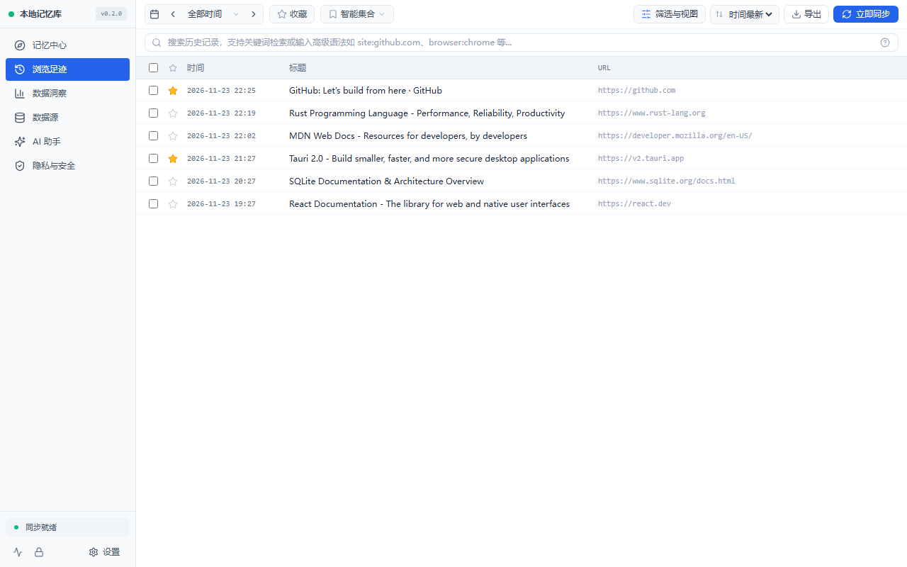
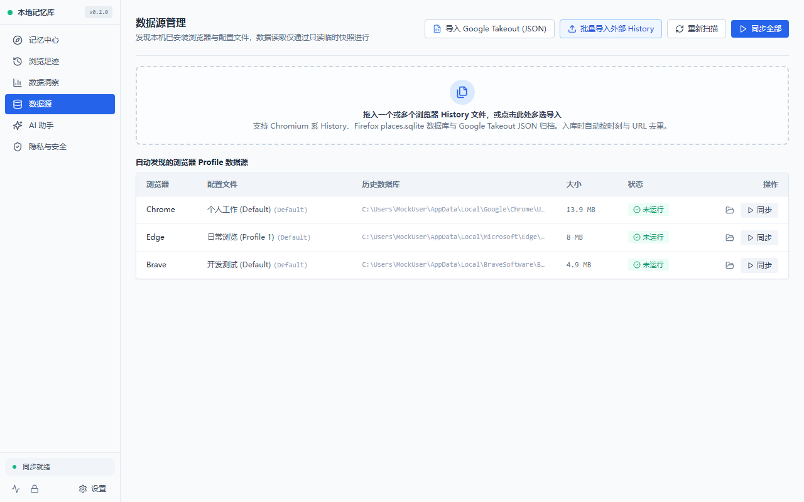

<div align="center">


# Browsory 浏览足迹

**在本机汇总、搜索和回看多个浏览器的历史记录。**

[](./LICENSE)
[](https://github.com/rowanjove/Browsory/releases)


[English](./README_EN.md) · **简体中文**

</div>

---

Browsory 是一款 Windows 桌面应用，可将多个浏览器的访问记录保存在一个本地归档中，方便检索、筛选和查看统计。默认不把浏览记录发送到开发者服务器。

## 功能

- **汇总浏览器历史**：发现 Chrome、Edge、Brave、Vivaldi、Opera、Arc、Firefox 和 Zen 的配置文件，通过临时副本读取历史数据库。
- **手动或定时同步**：按需同步所选来源，也可设置 Windows 计划任务定期增量同步。
- **搜索与分析**：使用 SQLite FTS5 搜索标题和网址，按浏览器、域名、时间和收藏状态筛选，并查看访问趋势与域名统计。
- **加密保险库**：数据库保险库使用 SQLCipher 加密本地归档，支持独立口令和恢复密钥。首次设置或迁移时请妥善保存恢复密钥。
- **网页归档**：保存网页内容和附件供离线阅读。
- **数据导入与导出**：导入 Google Takeout JSON 或外部 SQLite 历史库；可导出 CSV、JSON 和 Excel 文件。
- **可选 AI 与 WebDAV**：可配置本地或兼容 OpenAI 的 AI 服务。WebDAV 目前支持保存服务器设置和测试连通性，双向同步尚未开放。使用远程 AI 时，请求所需的历史内容会发送到所选服务。

## 界面预览







## 下载

从 [GitHub Releases](https://github.com/rowanjove/Browsory/releases) 下载 Windows x64 安装包或便携版。运行安装包需要 Microsoft Edge WebView2 Runtime。

便携版目录中需保留 `portable.txt`；应用数据保存在程序旁的 `data` 目录。安装版数据保存在当前 Windows 用户的数据目录中。

## 从源码构建

需要 Node.js 20.19 或更高版本、pnpm 9 或更高版本、Rust 1.89 或更高版本，以及 Windows C++ 构建工具。

```powershell
git clone https://github.com/rowanjove/Browsory.git
cd Browsory
pnpm install --frozen-lockfile
pnpm tauri dev
```

构建 Windows 安装包：

```powershell
pnpm build:windows
```

## 隐私与安全边界

- PIN 仅用于锁定应用界面，不加密数据库。数据库保险库使用独立口令或恢复密钥解锁。
- 迁移旧明文数据库时会保留一份明文备份，直到你在设置中主动退役。删除文件不等同于 SSD 物理擦除。
- CSV、JSON、Excel 导出文件不由保险库加密，请妥善保管。
- 浏览器自己的历史数据库不会被 Browsory 加密或删除。详细说明见[隐私与安全](./docs/PRIVACY.md)。

## 许可证

Browsory 使用 Apache License 2.0。第三方组件与随附 OpenSSL 文件的说明见[第三方许可](./docs/THIRD_PARTY_NOTICES.md)和仓库根目录的 [NOTICE](./NOTICE)。
