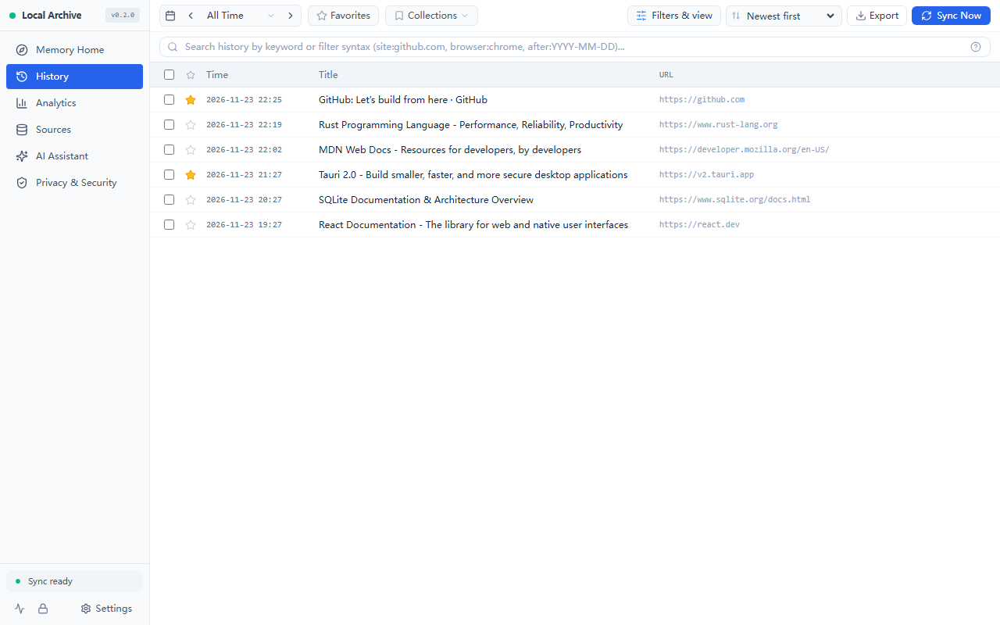
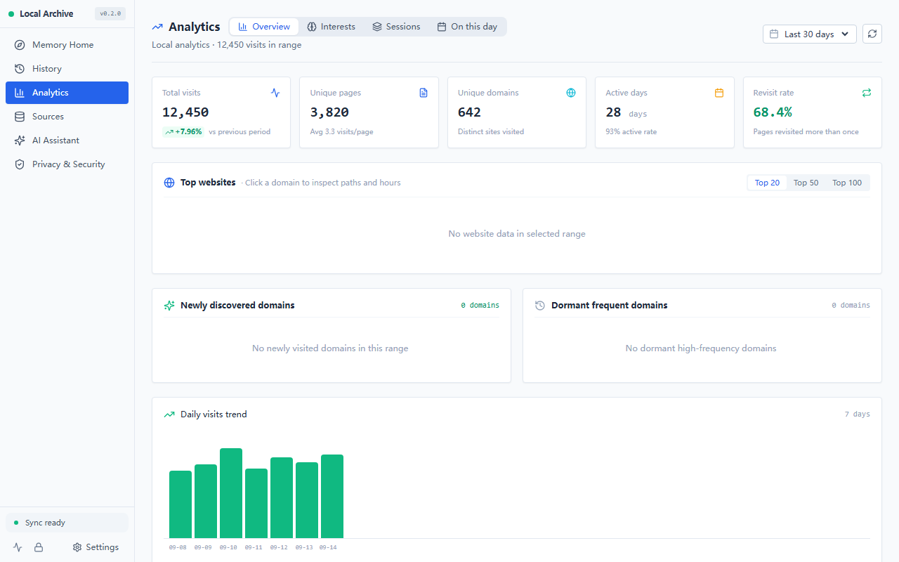
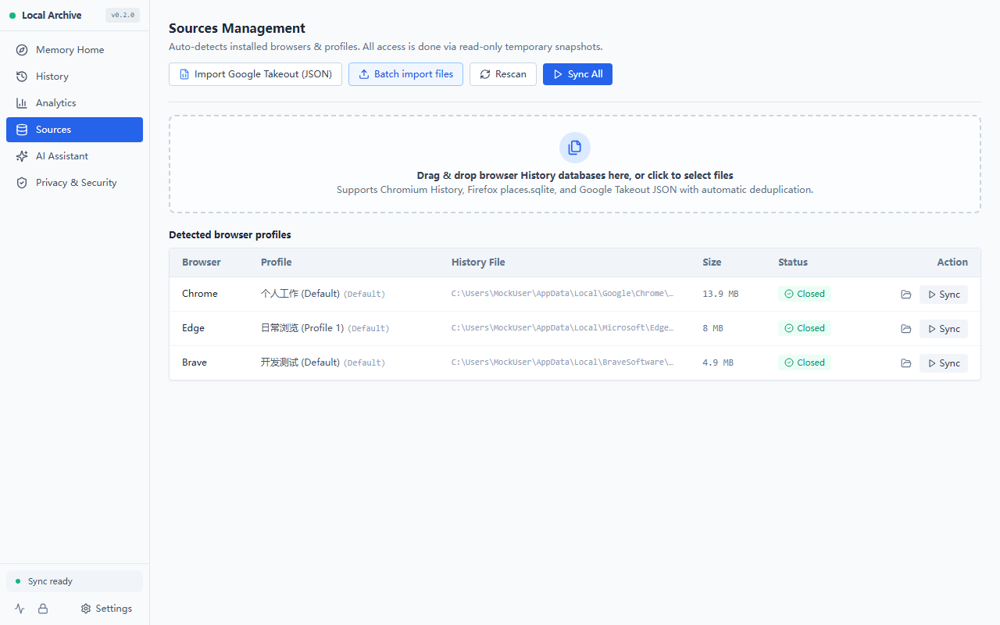
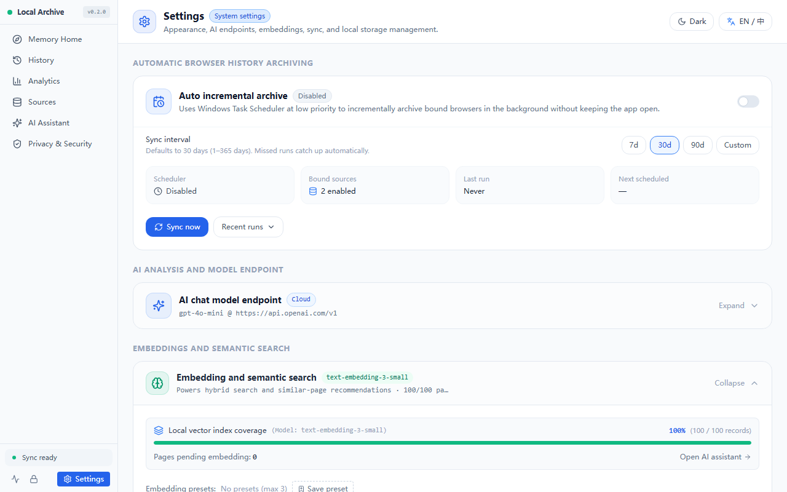

<div align="center">


# Browsory

**Archive, search, and revisit browser history on your Windows PC.**

[](./LICENSE)
[](https://github.com/rowanjove/Browsory/releases)


**English** · [简体中文](./README.md)

</div>

---

Browsory is a Windows desktop app that brings browser visits into one local archive for search, filtering, and analytics. Browsing history is not sent to a Browsory developer server by default.

## Features

- **Collect browser history** from Chrome, Edge, Brave, Vivaldi, Opera, Arc, Firefox, and Zen profiles using temporary copies of browser databases.
- **Sync manually or on a schedule** with Windows Task Scheduler for incremental updates from enabled sources.
- **Search and explore** titles and URLs with SQLite FTS5, filter by browser, domain, time, or favorites, and review visit trends and domain statistics.
- **Protect the local archive** with a SQLCipher database vault and a separate passphrase or recovery key. Save the recovery key during setup or migration.
- **Save web pages** with their content and attachments for offline reading.
- **Import and export data** from Google Takeout JSON or external SQLite history databases. Export CSV, JSON, or Excel files.
- **Optionally use AI and configure WebDAV** with a local or OpenAI-compatible AI service. WebDAV settings and connection testing are available; two-way sync is not yet supported. When using remote AI, the selected service receives the history content needed for the request.

## Screenshots









## Download

Download the Windows x64 installer or portable package from [GitHub Releases](https://github.com/rowanjove/Browsory/releases). The installer requires Microsoft Edge WebView2 Runtime.

For portable mode, keep `portable.txt` beside the executable. App data is stored in a sibling `data` directory. Installed builds store data in the current Windows user's data directory.

## Build from source

Requirements: Node.js 20.19 or later, pnpm 9 or later, Rust 1.89 or later, and the Windows C++ build tools.

```powershell
git clone https://github.com/rowanjove/Browsory.git
cd Browsory
pnpm install --frozen-lockfile
pnpm tauri dev
```

To build the Windows installer:

```powershell
pnpm build:windows
```

## Privacy and security boundaries

- The optional PIN locks the app interface; it does not encrypt the database. The database vault uses a separate passphrase or recovery key.
- Migration from an older plaintext database keeps a plaintext backup until you explicitly retire it in Settings. Deleting a file does not guarantee physical erasure from an SSD.
- CSV, JSON, and Excel exports are not encrypted by the vault. Store them carefully.
- Browsory does not encrypt or delete the original browser history databases. See [Privacy and Security](./docs/PRIVACY.md) for details.

## License

Browsory is licensed under Apache License 2.0. See [Third-Party Notices](./docs/THIRD_PARTY_NOTICES.md) and the repository's [NOTICE](./NOTICE) for third-party components and the bundled OpenSSL files.
